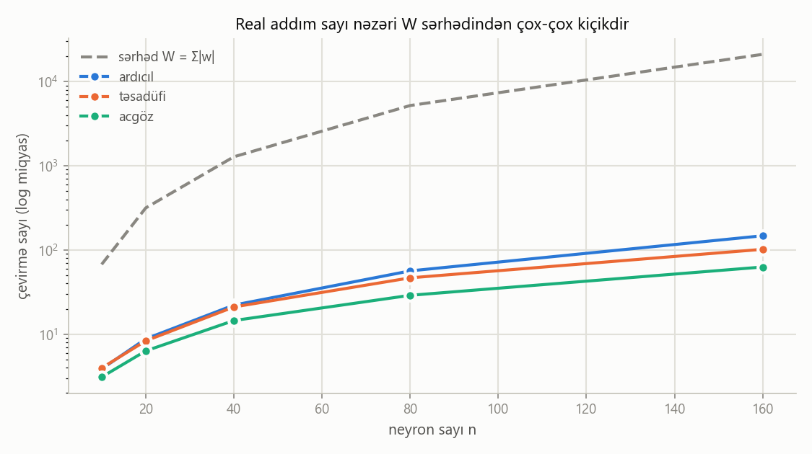
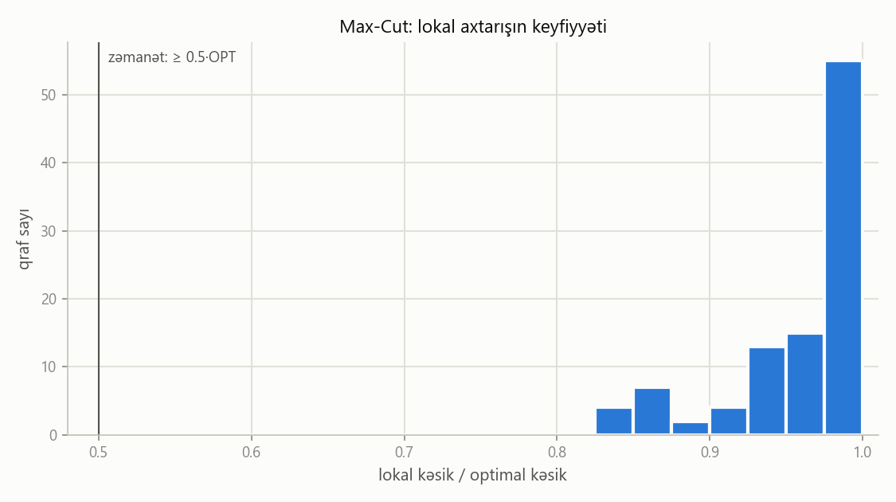
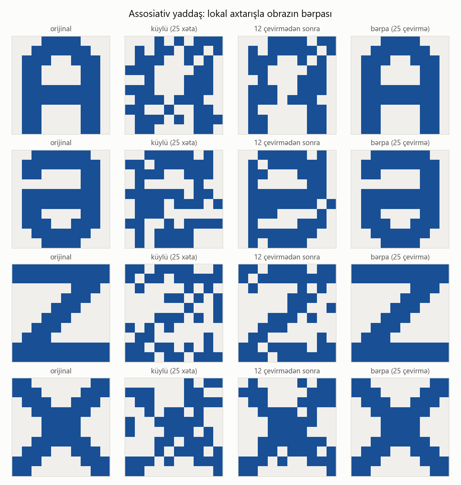

# Hopfild neyron şəbəkələrində lokal axtarış

**Fənn:** Alqoritmlərin analizi
**Mövzu:** Lokal axtarışın Hopfild neyron şəbəkələrinə tətbiqi (State-Flipping alqoritmi)
**Əsas mənbə:** J. Kleinberg, É. Tardos, *Algorithm Design*, §12.3–12.4

---

## Layihənin tərkibi

| Fayl | Nə edir |
|---|---|
| [`hopfield.py`](hopfield.py) | **Alqoritmin nüvəsi.** Hopfild şəbəkəsi, potensial funksiya Φ və State-Flipping alqoritmi. İşə salanda 6 neyronluq nümunəni addım-addım göstərir. |
| [`assosiativ_yaddas.py`](assosiativ_yaddas.py) | **Tətbiq.** Şəbəkə «A», «Ə», «Z», «X» hərflərini yadda saxlayır, küylü şəkli isə lokal axtarışla bərpa edir. |
| [`analiz.py`](analiz.py) | **Eksperimental analiz.** Dayanma teoremini yoxlayır, seçim strategiyalarını müqayisə edir, W sərhədinin psevdo-polinomial olduğunu göstərir və Max-Cut-da ½-approksimasiyanı təsdiqləyir. |
| [`index.html`](index.html) | **Dərsdə göstərmək üçün interaktiv nümayiş.** Alqoritmi qraf və 10×10 şəkil üzərində addım-addım göstərir. Nəzəriyyə və kod da buradadır. |
| `neticeler/` | Skriptlərin yaratdığı qrafiklər (PNG). |

## Necə işə salmaq

Python 3.8+ lazımdır. Qrafiklər üçün `matplotlib` istifadə olunur, amma məcburi deyil. Alqoritmin özü yalnız standart kitabxanadan istifadə edir.

```bash
python hopfield.py
```

```bash
python assosiativ_yaddas.py
```

```bash
python analiz.py
```

İnteraktiv nümayiş üçün `index.html` faylını brauzerdə açmaq kifayətdir, internet və server lazım deyil.
Birbaşa lazımi bölməni açmaq üçün ünvanın sonuna `#qraf`, `#yaddas` və ya `#nezeriyye` əlavə edin.
Klaviatura: `→` bir addım, `P` başlat/dayandır, `R` sıfırla.

---

## 1. Məsələnin qoyuluşu

- Hopfild şəbəkəsi yönləndirilməmiş **G = (V, E)** qrafıdır. Hər təpə bir neyrondur, hər tilin **tam ədəd** çəkisi `w_e` var.
- **Konfiqurasiya** S hər neyrona bir vəziyyət verir: `s_u ∈ {−1, +1}`.
- `e = (u, v)` tili **yaxşıdır**, əgər `w_e · s_u · s_v < 0`, əks halda **pisdir**.
  `w_e < 0` olanda u və v eyni vəziyyətdə olmaq istəyir, `w_e > 0` olanda fərqli.
- u neyronu **razıdır**, əgər ona bitişik yaxşı tillərin çəkiləri cəmi pis tillərinkindən kiçik deyilsə:
  `Σ_v w_uv · s_u · s_v ≤ 0`.
- Bütün neyronlar razıdırsa, konfiqurasiya **stabildir**.

**Sual:** stabil konfiqurasiya həmişə varmı və onu necə tapmaq olar?

## 2. Lokal axtarış: State-Flipping alqoritmi

```
State-Flipping(G, w, S):
    while S stabil deyil:
        u ← razı olmayan istənilən neyron
        s_u ← −s_u                 ▹ Φ(S) ən azı 1 artır
    return S                       ▹ stabil konfiqurasiya
```

Axtarış fəzası 2ⁿ konfiqurasiyadır. Bir konfiqurasiyanın **qonşuları** tək bir neyronu çevirməklə alınanlardır (Hamming məsafəsi 1).

## 3. Teorem (dayanma) və isbatı

> **Teorem.** State-Flipping alqoritmi ən çox `W = Σ_e |w_e|` iterasiyadan sonra dayanır və stabil konfiqurasiya qaytarır.
> Deməli, **hər Hopfild şəbəkəsinin ən azı bir stabil konfiqurasiyası var.**

**İsbat.** Potensial funksiyanı belə götürək: `Φ(S) = Σ_{e yaxşı} |w_e|`. Aydındır ki, `0 ≤ Φ(S) ≤ W`.

Razı olmayan u neyronunu çevirək. u-ya bitişik yaxşı tillərin çəki cəmi `g_u`, pis tillərinki `b_u` olsun.
Çevirmədən sonra u-ya bitişik yaxşı tillər pis olur, pis tillər isə yaxşı. Qalan tillər dəyişmir:

```
Φ(S') = Φ(S) − g_u + b_u
```

u razı olmadığı üçün `b_u > g_u`. Çəkilər tam ədəd olduğundan `b_u ≥ g_u + 1`, deməli `Φ(S') ≥ Φ(S) + 1`.
Φ hər addımda ən azı 1 artır və W-dən böyük ola bilmir. Ona görə addımların sayı ≤ W olur. ∎

**Enerji ilə əlaqə.** `E(S) = Σ_e w_e s_u s_v` götürsək, `Φ = (W − E) / 2`.
Yəni Φ-nin artması Hopfild enerjisinin azalmasıdır, stabil konfiqurasiyalar isə enerjinin **lokal minimumlarıdır**.

## 4. Mürəkkəblik

Kodda hər neyron üçün `h_u = Σ_v w_uv s_v` sahəsi və razı olmayan neyronlar çoxluğu saxlanılır:

| Əməliyyat | Vaxt |
|---|---|
| Başlanğıc: bütün `h_u`-ları hesablamaq | O(n + m) |
| Bir çevirmə (`h_v`-ləri və çoxluğu yeniləmək) | O(deg u) |
| Addımların sayı | ≤ W |
| **Ümumi** | **O(m + W·Δ)**, Δ – maksimal dərəcə |

Bu sərhəd **psevdo-polinomialdır**. W çəkilərin qiymətindən asılıdır, onların bit uzunluğundan yox.
Stabil konfiqurasiyanı polinomial vaxtda tapan alqoritmin olub-olmadığı **açıq məsələdir**. Bu məsələ PLS-tamdır (Schäffer & Yannakakis, 1991).

## 5. Max-Cut ilə əlaqə (KT §12.4)

Bütün çəkilər müsbət olsun. Onda yaxşı til (A = {s = +1}, B = {s = −1}) kəsiyindən keçən tildir və Φ kəsiyin çəkisinə bərabərdir.
State-Flipping alqoritmi Max-Cut üçün lokal axtarışa çevrilir. Teorem: istənilən lokal optimal kəsik üçün `w(A, B) ≥ W/2 ≥ OPT/2`.
Yəni lokal axtarış **2-approksimasiya** verir.

## 6. Tətbiq: assosiativ yaddaş

10×10 şəkil 100 neyrondur. P obraz **Hebb qaydası** ilə yadda saxlanılır: `w_ij = −Σ_p ξᵖ_i ξᵖ_j`.
Mənfi işarə KT konvensiyasından gəlir, çünki burada mənfi çəki «eyni vəziyyət» deməkdir.
Bu halda yadda saxlanılan obrazlar stabil konfiqurasiyalar olur.
Küylü şəkildən başlanan lokal axtarış Φ-ni addım-addım artırır və şəbəkəni ən yaxın stabil konfiqurasiyaya, adətən orijinal hərfə aparır.
**Xatırlama prosesi lokal axtarışın özüdür.**

---

## Nəticələr

### Kiçik nümunə (`python hopfield.py`)

n = 6, m = 9, W = 53. Başlanğıc S₀ = [+ + + + + +], Φ = 19.
Alqoritm 6 çevirmədən sonra S* = [+ − + − + +] stabil konfiqurasiyasını tapır, burada Φ = 38.
Bütün 64 konfiqurasiyanın tam yoxlaması göstərir ki, qlobal maksimum Φ = 48-dir.
Deməli, stabil konfiqurasiya **lokal** optimumdur, qlobal optimum olmaya da bilər.
İnteraktiv nümayişdə stabil haldan sonra 5-ci neyrona klikləyib alqoritmi «ardıcıl» strategiya ilə yenidən işə salsanız, o, 2 addımda Φ = 48 olan qlobal optimuma gedir.
Bu, lokal axtarışda istifadə olunan «silkələmə / yenidən başlama» ideyasıdır.

### Dayanma teoremi və strategiyalar (`python analiz.py`)

Təsadüfi qraflarda orta çevirmə sayı (çəkilər ∈ [−10, 10], p = 0.3, hər n üçün 30 qraf):

| n | W (orta) | ardıcıl | təsadüfi | acgöz |
|---:|---:|---:|---:|---:|
| 10 | 68 | 3.9 | 4.0 | 3.1 |
| 20 | 316 | 8.8 | 8.3 | 6.3 |
| 40 | 1 280 | 22.2 | 21.1 | 14.5 |
| 80 | 5 199 | 56.5 | 46.7 | 29.0 |
| 160 | 21 083 | 147.7 | 101.9 | 62.8 |

Bütün sınaqlarda Φ hər addımda ≥ 1 artdı və addım sayı ≤ W oldu.
Real addım sayı W-dən 100 dəfədən çox kiçikdir. Acgöz strategiya ən az addım tələb edir.



**Max-Cut** (n = 12, 100 qraf): lokal kəsik / optimal kəsik nisbəti min = 0.831, orta = 0.962. 36 halda tam optimum tapıldı. Zəmanət ≥ 0.5 idi.



### Assosiativ yaddaş (`python assosiativ_yaddas.py`)

| küy | 0% | 10% | 20% | 30% | 35% | 40% | 45% | 50% |
|---|---:|---:|---:|---:|---:|---:|---:|---:|
| düzgün bərpa | 100% | 100% | 99% | 91% | 86% | 61% | 31% | 2% |



---

## Təqdimat üçün təklif olunan ardıcıllıq

1. **Məsələ:** `index.html` → «Nəzəriyyə və kod» bölməsində tərifləri göstərin (yaxşı/pis til, razı neyron, stabil konfiqurasiya).
2. **Alqoritm:** «Alqoritm qraf üzərində» bölməsində `→` düyməsi ilə addım-addım gedin.
   Hər addımda qırmızı halqalı neyron çevrilir, «y < p» şərti görünür, Φ isə artır. Psevdokodun aktiv sətri işıqlanır.
3. **Teorem:** Φ diaqramında Φ-nin hər addımda artdığını və W xəttini keçmədiyini göstərin. Sonra isbatı danışın.
4. **Lokal ≠ qlobal:** stabil haldan sonra 5-ci neyrona klikləyin və alqoritmi «ardıcıl» strategiya ilə yenidən işə salın. Bu dəfə Φ = 48 (qlobal optimum) alınır.
5. **Kod:** `hopfield.py` faylında `state_flipping` funksiyasını göstərin və terminalda `python hopfield.py` işə salın.
6. **Tətbiq:** «Assosiativ yaddaş» bölməsində «Ə» hərfini seçin, 25% küy əlavə edin və «Başlat» düyməsini basın.
7. **Analiz:** `python analiz.py` nəticələrini, yəni cədvəli və qrafikləri göstərin. Mürəkkəblik və psevdo-polinomiallıq haqqında danışın.

## Ədəbiyyat

1. J. Kleinberg, É. Tardos. *Algorithm Design*. Pearson, 2006. §12.3–12.4.
2. J. J. Hopfield. Neural networks and physical systems with emergent collective computational abilities. *PNAS*, 79(8), 1982.
3. A. A. Schäffer, M. Yannakakis. Simple local search problems that are hard to solve. *SIAM J. Computing*, 20(1), 1991.
